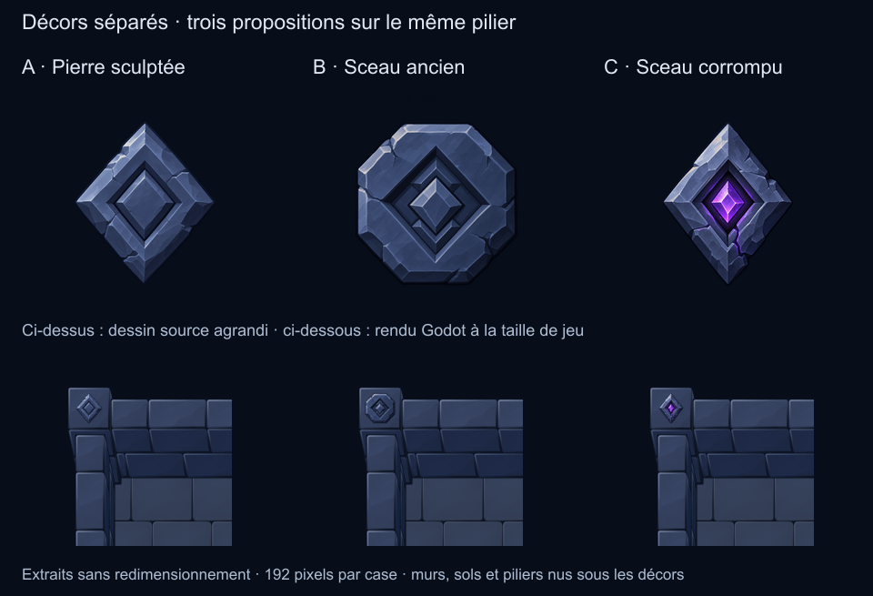

# Décors peints séparés — 24 octobre 2026

**Revue historique :** l'utilisateur a rejeté leur manque de lisibilité à la
taille de jeu et leur apparence collée. La nouvelle proposition est le
[dessus de pilier sculpté](../pillar-cap-review/README.md). Les sources restent
figées ; la planche historique utilise `source/captures/` pour conserver les vues
de cette étape. A/B/C ne sont plus le choix initial de la scène.

L'utilisateur souhaite conserver les murs, sols et piliers nus et ajouter des
décors indépendants de meilleure qualité. Les anciens losanges procéduraux sont
rejetés visuellement. Cette revue propose trois dessins, sans sélection finale :

- **A — Pierre sculptée** : losange en ardoise, biseaux, creux central et éclats.
- **B — Sceau ancien** : cadre octogonal usé et relief central.
- **C — Sceau corrompu** : sertissage de pierre et petite lueur violette.

La rangée supérieure montre les sources agrandies. La rangée inférieure montre
des extraits des captures Godot 1280×720 sans redimensionnement, à 192 pixels par
case. Un navigateur peut redimensionner la planche entière pour l'afficher.

## Dans Godot

Ouvrir `scenes/MobileReference.tscn`, puis F6. Les choix **Ancien A/B/C** changent les
piliers. A était le choix initial pour cette revue, pas une approbation. Les anciens exemples
de murs utilisent C à une échelle uniforme de 0,72. Désactiver **Anciens décors murs** et
**Décors piliers** montre la même scène avec ses bases nues.

Les sprites sont `decor-a`, `decor-b`, `decor-c`, dans les deux atlas du
prototype. Chaque décor suit immédiatement son support dans le tri par
profondeur ; les murs au premier plan peuvent donc le masquer. Ces reliefs
occupent les plans supérieurs horizontaux avec une translation selon la hauteur
du support. Les façades inclinées demanderaient leur propre art projeté ; aucune
déformation de perspective ni génération de texture n'a lieu en jeu.

## Sources et préparation

- `source/a.png`, `b.png`, `c.png` : originaux ImageGen copiés sans changement,
  transparence native. Maquette, pilier de référence et base nue ont servi de
  références. `generation.json` conserve les prompts exacts et chemins d'origine.
- `source/scene-before.png` : capture du prototype avec les anciens losanges et
  le tri de profondeur déjà corrigé, conservée comme historique.
- `tools/mobile_painted_decorations.cjs` : conserve l'intégralité des pixels
  d'origine, réduit uniformément et ajoute une marge transparente. La mesure
  alpha >8 sert seulement à centrer le sujet, jamais à retirer des pixels.
- Cadre commun 68×68 pixels à la densité 256 ; grand côté du sujet 44 pixels,
  soit environ 33 pixels affichés au cadrage proposé. `prepared/` montre les
  PNG de cette densité. Pas de recoloration, masque ou réparation de dessin.
- `mobile-optimization/recipe.json` enregistre hashes, dimensions, centrage,
  sources et paramètres. La géométrie des bases n'a pas été modifiée ici.

Reproduction, avec Node/Sharp et Godot disponibles :

1. `node tools/prepare_mobile_reference.cjs` : export atlas et recette.
2. Import Godot (`--headless --editor --import`).
3. Godot avec rendu réel, `--script res://tools/capture_mobile_reference.gd`.
4. `node tools/prepare_mobile_reference_review.cjs` : couches et comparatifs.
5. `node tools/prepare_mobile_decoration_review.cjs` : cette planche.

Le prototype garde 13 images logiques. Atlas 128 : 512×256, 74238 octets PNG ;
atlas 256 : 1024×512, 210009 octets PNG. Ces chiffres ne couvrent pas le futur
catalogue complet. Les ressources obsolètes `ornament-h/v/pillar.tres` ont été
retirées des deux atlas du prototype ; leurs anciens PNG de revue sont conservés.

## Limites de la revue

Import et huit captures Godot effectués, journaux stderr vides. A/B/C examinés
dans la scène à l'échelle de jeu et sur cette planche. Aucun test automatisé ni
profilage sur téléphone. Il s'agit d'une revue d'apparence dans la scène mobile
isolée, sans remplacement des anciens catalogues ou scènes de production.
Une bibliothèque de fissures, racines et autres éléments reste à concevoir.
