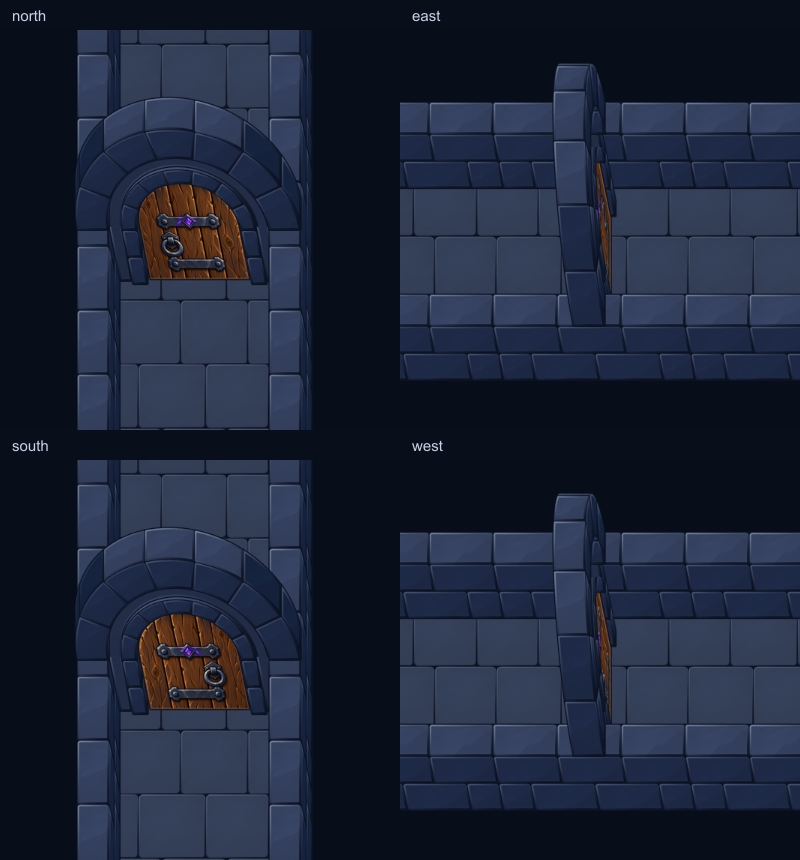

# Porte approuvée intégrée au kit mobile

Le « Vas-y » de l’utilisateur autorise la promotion de la géométrie **v8** et
de l’apparence **art-v2** précédemment validées. Les sources d’approbation restent
figées dans leurs dossiers ; leurs anciens états « intégration à effectuer »
décrivent le moment de l’approbation. Le présent bilan décrit la production.

## Résultat

- Les quatre orientations utilisent la grande arche originale, une petite arche,
  le mur lisse en retrait et le vantail arqué aux ferrures espacées des bords.
- Les 21 scènes d’architecture consomment le même catalogue. Les emplacements
  existants de portes sont dans WireframeDoorCross et ReferenceCalibration.
  Aucun layout ni escalier n’a été modifié pour ajouter artificiellement des portes.
- Huit composants préparés par orientation permettent aux murs de premier plan
  de masquer correctement le bois et les différentes parties du cadre.

| Mesure | Avant | Après |
| --- | ---: | ---: |
| Sprites préparés dans le kit | 23 | 47 |
| Atlases | 1 | 1 |
| Dimensions | 1024 × 2048 | 1024 × 2048 |
| Mémoire RGBA de l’atlas | 8 Mio | 8 Mio |
| PNG de l’atlas | 635 387 octets | 820 667 octets |
| Paquet de ressources Godot | 468 522 octets | 609 890 octets |

Le paquet conserve 40 dépendances sources et une seule texture importée. Il
n’inclut pas les peintures originales, matières et revues d’auteur. Il ne s’agit
pas d’un APK ; aucune mesure de performances sur téléphone n’est revendiquée.

## Préparation et placement

`tools/mobile_approved_doors.cjs` vérifie les empreintes des approbations, impose
le matériau art-v2 et réexporte les composants depuis la géométrie v8. Les 28
pièces approuvées doivent conserver leurs pixels, ancrages et volumes de support.
La grande arche est contrôlée contre l’atlas figé initial au même stade de
composition alpha : le packing peut arrondir de ±1 les canaux RGB de pixels
partiellement transparents, sans changement de peinture.

Le catalogue déclare les six parties de pierre ajoutées dans `companions` sur
chaque vantail. Le renderer place leurs AtlasTextures puis utilise son ordre de
profondeur physique habituel. Aucune peinture ni déformation n’est calculée dans
Godot. Les anciens outils de revue chargent leur catalogue figé sans companions,
ce qui évite d’ajouter deux fois la maçonnerie.

Reproduction : suivre les commandes du [kit mobile](../../mobile-kit/README.md).
Les approbations figées ne doivent pas être régénérées pour contourner un écart.

## Contrôles effectués

`report.json` détaille les 47 comparaisons de régions du nouvel atlas : les 28
composants approuvés correspondent à art-v2 ; les quatre arches principales et
les 15 autres sprites correspondent à l’atlas initial. Pixels, offsets, tailles
et volumes sont identiques aux références respectives.

Import Godot, 60 captures des 21 scènes, import du dossier de déploiement neuf,
export et ouverture du paquet : codes de sortie 0 et stderr vide. Les planches
des quatre orientations, ReferenceCalibration et les scènes ont été inspectées.
La revue indépendante n’a relevé aucun problème de code actionnable.

Treize captures supplémentaires en contexte éditeur couvrent WireframeDoorCross,
ReferenceCalibration et MobileReference. Les sept vues centrées sur les portes
et escaliers correspondent exactement au jeu ; les trois vues d’ensemble et la
vue native MobileReference aussi. Les deux autres vues natives ont un cadrage
différent : leur caméra d’édition reste à zoom 1, tandis que le script de scène
non `@tool` initialise le jeu à 0,75. Les vues centrées imposent ce même cadrage
et permettent de comparer les assets. Le helper éditeur sort avec code 0 mais
émet des diagnostics natifs d’écran, de fenêtre de progression et de ressources
à sa fermeture ; son stderr est conservé et n’est pas vide.

Les logs de cette exécution sont conservés dans `logs/`. Aucun test automatisé
n’a été ajouté ou lancé, aucun commit/push effectué. Ces captures ne valident
pas toutes les configurations futures de donjon.
