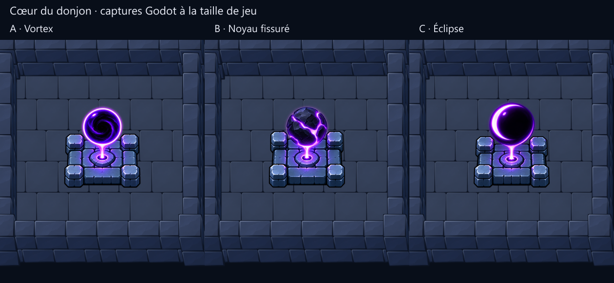

# Cœur du donjon : trois propositions de sprite

**Dernier retour : socle sculpté et vortex validés (« Ok »).**
La [version retenue](ritual-v3/) enrichit le socle en conservant l’orientation
corrigée et le vortex. La sélection est enregistrée avec les empreintes des
images présentées. Les trois propositions initiales ci-dessous sont historiques.

**Retour suivant : perspective à revoir.** L’utilisateur trouve l’angle de vue
des trois premières propositions incorrect. Une [correction sur A](perspective-v2/)
replace le dessus du socle dans le plan du sol. Les comparaisons ci-dessous
conservent la première proposition ; elles ne sont pas une validation artistique.

L’utilisateur demande plusieurs propositions et des tests après avoir précisé
que le jeu repose sur une grille 2D : le sol reste à plat, tandis que le dessin
des objets donne une illusion de volume. Le cœur est donc un sprite complet
avec socle et orbe, sans wireframe architectural ni déformation de perspective.

**État actuel : cœur validé et [intégré au kit actif](ritual-v3/integration/).**

## Comparaison à la distance de jeu



- **A — Vortex** : proche de l’ancien cœur, ouverture sombre et spirale violette.
- **B — Noyau fissuré** : masse rocheuse fendue, aspect plus matériel et lourd.
- **C — Éclipse** : grande surface sombre et croissant lumineux, lecture simple.

Les trois conservent le socle carré et quatre pierres d’angle. La taille proposée
du socle est d’environ **156 pixels affichés**, pour une case de 192 pixels et
un zoom de 0,75. Ces dimensions et l’apparence restent des propositions.

À mon appréciation visuelle, C garde la silhouette la plus simple, A conserve
le mieux le motif du vortex original et B donne davantage une impression de
matière. La lumière peinte du socle est plus vive que celle des murs environnants.
Il n’y a pas de lumière dynamique dans ces comparaisons.

## Sources et préparation

Les trois images ont été produites avec l’outil **ImageGen intégré**. Les prompts
exacts, les trois références et les chemins de génération sont enregistrés dans
[generation.json](generation.json). Les originaux avec leur transparence native
sont conservés dans [source/a.png](source/a.png), [source/b.png](source/b.png)
et [source/c.png](source/c.png).

La préparation mesure la largeur opaque du socle dans la moitié basse de chaque
source puis réduit uniformément **l’image entière**. Le seuil alpha sert seulement
à mesurer ; aucun pixel n’est détouré, masqué ou recoloré. Les faibles halos alpha
sont conservés. L’ancrage au centre de l’emprise au sol est proposé séparément de
la silhouette peinte. Voir [prepared.json](prepared.json).

| Proposition | PNG à densité 256 | Taille du PNG | PNG à densité 128 | Taille du PNG |
| --- | --- | ---: | --- | ---: |
| A | 316 × 309 | 110 762 octets | 158 × 154 | 31 103 octets |
| B | 345 × 337 | 119 458 octets | 173 × 169 | 33 253 octets |
| C | 354 × 346 | 109 642 octets | 177 × 173 | 30 978 octets |

Les versions réduites sont dans `prepared/`. L’essai à densité 128 les affiche
à la même taille de jeu, sans changer les murs ni le cadrage. Il divise à peu
près par quatre la mémoire RGBA du sprite, mais adoucit les pierres et les
contours : comparer [les deux résolutions](comparison.png) à 100 %.

## Tests autorisés par l’utilisateur

- **18 captures Godot** : chaque proposition au centre dans deux résolutions,
  puis près des quatre murs à la résolution de référence.
- **128 contrôles réussis**, zéro échec : chargement des PNG complets, dimensions,
  échelle uniforme, absence de rotation, caméra fixe, présence des recouvrements
  à contrôler et ordre d’affichage devant le mur arrière/derrière le mur avant.
- [Planche des superpositions](occlusion-comparison.png), examinée visuellement.
- Import Godot et capture finale : sortie 0, stderr vide. Rapport détaillé dans
  [godot-report.json](godot-report.json), logs dans `logs/`.

Le premier essai a révélé que `docs/` est exclu de l’import Godot. Le helper lit
maintenant les PNG préparés directement, comme les revues de portes. Il ne dessine
aucun pixel. Les contrôles signalent explicitement une texture absente et une
série incomplète au lieu de laisser passer une capture sans objet.

L’ordre d’affichage réutilise le renderer commun dans une sous-classe de revue,
avec une emprise indicative du cœur. Ce volume sert uniquement au tri ; il ne
projette ni ne déforme l’image. Les essais ne valident pas des collisions, le
passage d’un héros, des animations, tous les futurs placements ou des performances
sur un téléphone. Le renderer de production n’a pas été modifié pour ce cœur.

## Reproduction

```powershell
node tools/prepare_mobile_heart_review.cjs
godot --headless --editor --path . --import
godot --path . --rendering-method gl_compatibility --script res://tools/capture_mobile_heart_review.gd
node tools/prepare_mobile_heart_review.cjs --boards
```

Le script conserve les peintures générées ; il ne relance pas ImageGen.
Une scène de comparaison locale est disponible dans `HeartProposals.tscn` :

```powershell
godot --path . res://docs/reference/mobile-heart-review/HeartProposals.tscn
```

Cette scène reste dans le dossier de revue exclu de l’export. La revue initiale
avait préservé le cœur existant et l’atlas ; ses empreintes sont dans `prepared.json`.
L’intégration ultérieure du cœur sélectionné est documentée séparément.
L’apparence retenue et ses empreintes sont consignées dans `ritual-v3/selection.json`.
