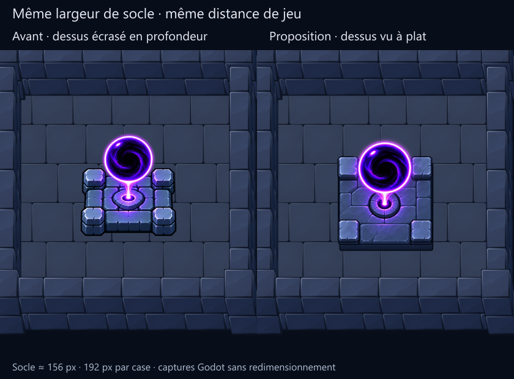

# Correction proposée : socle dans le plan du sol

**Retour suivant : orientation acceptée, vortex retenu.** L’utilisateur juge
cette nouvelle image bonne mais demande un socle plus travaillé et impressionnant.
La [retouche suivante](../ritual-v3/) conserve cette direction. Les mentions de
validation en attente ci-dessous décrivent l’état lors de cette première revue.

L’utilisateur trouve la perspective des trois premières propositions incorrecte.
Leur socle reprend un dessus raccourci en profondeur, des petites pierres vues de
trois quarts et un logement central elliptique. Cela s’accorde mal avec le sol
du kit, dont les distances horizontales et verticales ne sont pas raccourcies.

La liberté d’un sprite 2D concerne son dessin de volume ; elle ne dispense pas
d’accorder son support au plan du sol. Les premiers contrôles validaient le
chargement, la taille et les superpositions, **pas la justesse artistique de
l’angle de vue**.



## Ce qui change

- Une seule variante est reprise : **A**, pour comparer la structure sur un
  même motif. Ce choix de travail ne constitue pas une sélection de l’utilisateur.
- Le dessus du socle et les pierres d’angle sont vus davantage à plat, avec une
  emprise carrée et un logement central rond. Le rebord frontal est moins haut.
- L’orbe demeure un élément dessiné en volume au-dessus de son support.
- Largeur du socle identique : environ 156 pixels affichés. Même salle, caméra
  0,75 et 192 pixels affichés par case. Le sprite est seulement réduit uniformément.

**Proposition à valider visuellement.** Ne pas présenter une génération d’image
comme une correspondance géométrique parfaite, ni propager aux autres variantes
avant le retour de l’utilisateur.

## Méthode et fichiers

Une première retouche ImageGen conservait trop de raccourcissement : elle reste
dans `source/first-retouch.png` comme essai insuffisant. La seconde utilise une
simple référence de composition 2D : [source/flat-layout.png](source/flat-layout.png).
Ce dessin contraint le carré du dessus et le cercle du logement, sans calculer
un wireframe 3D de tout l’objet.

Références de la seconde retouche, dans l’ordre : le dessin à plat, la source A
précédente (`../source/a.png`, apparence uniquement) et le décor mobile
(`../../mobile-kit/captures/MobileReference-native.png`). Les deux prompts et les
chemins de génération ImageGen sont dans [generation.json](generation.json).
La nouvelle peinture native-alpha est [source/a.png](source/a.png).

La préparation conserve tous les pixels alpha et réduit uniformément l’image.
Le seuil alpha mesure le socle seulement. Ancrage et volume de support indicatifs
suivent désormais une emprise carrée de 0,8125 × 0,8125 case. Ce volume sert au tri
des superpositions uniquement ; il ne projette ni ne déforme la peinture.

## Contrôles

- Six captures : centre à densités 256 et 128, puis près de chacun des quatre murs.
- 44 contrôles réussis, zéro échec, sortie Godot 0 et stderr vide.
- Avant/après et occultation du bas du socle par le mur avant inspectés.
- Atlas, catalogue actif, ancien cœur et sa scène : empreintes inchangées.
- Aucune validation d’animation, de déplacement de héros, de collision ni de
  performance sur téléphone. Aucune intégration au jeu ou sélection artistique.

Voir [godot-report.json](godot-report.json), `prepared.json` et `logs/`.

```powershell
node tools/prepare_heart_flat_layout.cjs
# La peinture ImageGen enregistrée est conservée, pas régénérée.
node tools/prepare_heart_perspective_review.cjs
godot --path . --rendering-method gl_compatibility --script res://tools/capture_mobile_heart_review.gd -- --perspective-v2
node tools/prepare_heart_perspective_review.cjs --boards
```

Les premières propositions et leurs comparaisons restent intactes pour
documenter le retour utilisateur. Aucun commit/push demandé.
