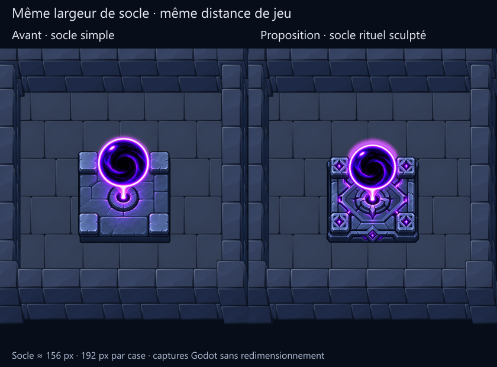

# Cœur du donjon : socle rituel sculpté

L’utilisateur aime le vortex et juge bonne la correction précédente, mais trouve
le socle trop simple pour l’élément central du donjon. Cette retouche conserve
l’orientation du support et le motif du vortex, en enrichissant la pierre.

**État : apparence validée par l’utilisateur (« Ok »).** Le choix porte sur le
socle sculpté, le vortex et l’orientation montrés dans la comparaison ci-dessous.
[Sélection et empreintes exactes](selection.json). Le « Oui » suivant a autorisé
l’[intégration en production](integration/), désormais réalisée. Cette page conserve
les conditions et résultats de la revue artistique initiale.

## À la distance de jeu



Les deux images sont des captures Godot sans redimensionnement : zoom 0,75,
192 pixels affichés par case et socle d’environ 156 pixels de large.

- Quatre pierres d’angle avec grands motifs sculptés et foyers violets.
- Foyer central entouré de moulures et d’un champ géométrique creusé.
- Rainures lumineuses, bordure à degrés et emblème frontal.

À cette taille, les motifs principaux restent distincts. La nouvelle peinture
est plus contrastée et plus lumineuse que le décor ; cet accent attire le regard
sur le cœur. L’utilisateur a retenu cette apparence.

## Sources et préparation

[ImageGen original](source/a.png), [prompt exact et référence](generation.json),
[dimensions, ancres et empreintes](prepared.json).

Les statuts contenus dans `generation.json` et `prepared.json` sont ceux de la
préparation avant validation. `selection.json` consigne le retour ultérieur.

La référence est uniquement le sprite corrigé `../perspective-v2/source/a.png`.
Le fichier généré est conservé sans retouche de pixels. La préparation mesure la
maçonnerie basse pour l’ancrage puis réduit uniformément l’image entière avec son
alpha natif ; le seuil alpha ne sert qu’à la mesure. Aucun détourage, changement
de couleur ou déformation de perspective n’est effectué après ImageGen.

| Densité source | Dimensions | PNG | RGBA non compressé |
| --- | --- | ---: | ---: |
| 256 px/case | 289 × 289 | 137 216 octets | 334 084 octets |
| 128 px/case | 144 × 144 | 36 536 octets | 82 944 octets |

L’emprise carrée indicative de 0,8125 case sert uniquement à l’ordre d’affichage.
La peinture n’est pas une géométrie architecturale exacte.

## Essais autorisés

Six captures : centre aux deux densités, puis près de chacun des quatre murs.
**44 contrôles réussis, zéro échec**, sortie Godot 0, stderr vide. Ils couvrent le
chargement, les dimensions, l’échelle uniforme, la caméra fixe et les superpositions.
L’avant/après et le masquage par le mur avant ont été examinés visuellement.

[Rapport](godot-report.json), [mur avant](captures/a-256-south.png), logs dans
`logs/`. Atlas, catalogue, ancien cœur et sa scène : empreintes inchangées par
rapport à la référence figée. Ces essais ne valident ni collisions, ni animation,
ni performances sur téléphone. Aucun test sans lien avec cette revue n’a été lancé.

## Reproduction

```powershell
node tools/prepare_heart_perspective_review.cjs --ritual-v3
godot --path . --rendering-method gl_compatibility --script res://tools/capture_mobile_heart_review.gd -- --ritual-v3
node tools/prepare_heart_perspective_review.cjs --ritual-v3 --boards
```

La préparation utilise la peinture enregistrée sans relancer ImageGen. Cette
revue n’avait pas modifié les scènes actives ; l’intégration suivante les met à jour.
Ses empreintes de référence sont historiques et ne doivent pas être réécrites
pour faire passer la préparation contre le nouvel atlas actif.
