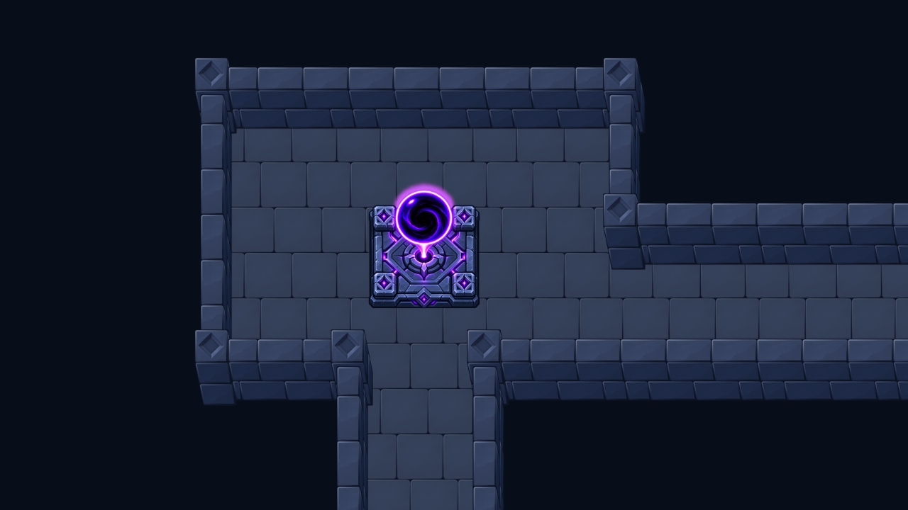

# Intégration du cœur sculpté dans Godot

Le « Oui » de l’utilisateur autorise l’intégration après validation du socle
sculpté, du vortex et de l’orientation. Le sprite préparé approuvé est placé dans
l’atlas actif sans nouvelle génération d’image.



## Scènes et placement

| Scène | Centre au sol, en cases |
| --- | --- |
| MobileReference | (1,5 ; 1) |
| SixRoomPreview | (12 ; 14), salle du bas au centre |
| DungeonPreview | (12 ; 14), même implantation |
| DungeonHeart | (0 ; 0), prop autonome |

Les positions des trois aperçus sont réglables avec **Dungeon → Heart Positions**.
Les autres études de géométrie restent sans cœur par défaut. F5 ouvre
MobileReference ; F6 lance la scène d’aperçu sélectionnée. Le zoom reste 0,75,
avec déplacement libre de la vue. Les dispositions des salles, des couloirs,
des portes et des entrées n’ont pas changé.

Le cœur est un sprite complet : 289 × 289 pixels, ancre au sol
`[144.5, 155.792663476874]`, socle d’environ 156 pixels affichés. Le volume
indicatif de 0,8125 × 0,8125 case et hauteur 0,98 sert uniquement au tri des
superpositions avec les murs et piliers. Il ne déforme pas la peinture et ne
constitue pas un système de collisions de jeu.

Le support doit rester entièrement sur du sol, hors d’une case d’escalier ou de
porte. Une position invalide est omise. `DungeonHeart.tscn` et `alpha_heart.gd`
réutilisent le même atlas ; l’ancienne grande image du cœur est désormais sans
référence runtime. Le halo peint de l’image approuvée est conservé, sans ajouter
une lumière dynamique différente de la revue.

## Taille du kit

| Mesure | Avant le cœur | Avec le cœur |
| --- | ---: | ---: |
| Sprites préparés | 47 | 48 |
| Atlas | 1024 × 2048 | 1024 × 2048 |
| PNG atlas | 820 667 octets | 974 698 octets |
| RGBA non compressé | 8 Mio | 8 Mio |
| ZIP de ressources Godot | 609 890 octets | 705 339 octets |

L’atlas gagne 154 031 octets sur disque sans augmenter ses dimensions. Le ZIP
contient les ressources du jeu, sans moteur Android ni signature : ce n’est pas
un APK ou une mesure de performance sur téléphone. Le graphe explicite contient
42 fichiers source actifs pour 22 scènes, dont le prop DungeonHeart. L’ancienne
image du cœur, les peintures d’auteur et les kits retirés sont exclus du paquet.

## Contrôles et limites

- Le premier essai du contrôle ciblé échoue comme prévu sur l’absence du cœur
  dans le catalogue actif (`logs/red.*`). Après intégration : **60 contrôles
  réussis, zéro échec, 11 captures**. Ils couvrent placement, empreinte au sol,
  absence de duplication après rafraîchissement, exclusion portes/escaliers,
  échelle, ancrage, prop autonome et occultation devant/derrière les murs.
- Les **47 anciens sprites** conservent exactement leurs pixels et leurs
  ancrages/dimensions/volumes/compagnons après repacking. Le cœur correspond à
  l’image approuvée au même stade de composition alpha. Voir `atlas-report.json`.
- Les captures de revue utilisaient une ImageTexture directe, la production une
  texture importée en atlas. La capture centrale n’est pas strictement identique
  pixel par pixel : écart moyen absolu 0,00305 niveau, maximum 11/255, concentré
  sur quelques contours. Les pixels de l’atlas sont vérifiés séparément et les
  vues ont été inspectées. Ne pas présenter le rendu comme une égalité binaire
  avec cette ancienne capture.
- **63 captures runtime / 21 scènes**, sortie 0, stderr vide. **11 captures
  éditeur / 3 scènes** ; leurs vues centrées sur le cœur correspondent exactement
  au runtime à cadrage égal (`editor-report.json`). Le processus de capture
  éditeur sort avec le code 0 mais émet des diagnostics natifs de fenêtre,
  ressources et fermeture. Ses logs ne sont pas vides.
- L’import local, l’import du paquet préparé, l’export et l’ouverture du ZIP
  réussissent avec sortie 0 et stderr vide. Une revue de code indépendante n’a
  trouvé aucun problème actionnable dans l’intégration du cœur.
- Aucun test de déplacement de héros, animation, collision de jeu, performance
  mobile ou couverture de toutes les futures dispositions. Aucun commit/push.

La première capture générale a rencontré des verrous Windows sur d’anciens
fichiers de revue. Le helper a été interrompu, sans interrompre l’éditeur de
l’utilisateur. Les captures suivantes ont été enregistrées dans un dossier
neuf puis publiées par remplacement atomique. Le helper signale désormais un
échec d’écriture et quitte même si l’inventaire ne peut pas être créé.

## Reproduction

Avec Node/Sharp et Godot accessibles :

```powershell
node tools/export_mobile_kit.cjs
godot --headless --editor --path . --import
godot --path . --rendering-method gl_compatibility --script res://tools/capture_approved_heart.gd
node tools/prepare_approved_heart_review.cjs

# Utiliser un dossier neuf si les captures précédentes sont ouvertes/verrouillées.
$heartCaptureRoot = 'artifacts/heart-captures-' + (Get-Date -Format yyyyMMdd-HHmmss)
godot --path . --rendering-method gl_compatibility --script res://tools/capture_mobile_kit.gd -- "--output-root=res://$heartCaptureRoot"
godot --editor --path . --rendering-method gl_compatibility --script res://tools/capture_mobile_kit.gd -- "--output-root=res://$heartCaptureRoot" MobileReference SixRoomPreview DungeonPreview
node tools/prepare_approved_heart_review.cjs --publish-captures "--capture-root=$heartCaptureRoot"
node tools/prepare_mobile_kit_review.cjs

node tools/prepare_mobile_export.cjs
$heartExportInfo = Get-Content docs/reference/mobile-kit/export-inventory.json -Raw | ConvertFrom-Json
godot --headless --editor --path $heartExportInfo.staging --import
godot --headless --path $heartExportInfo.staging --export-pack 'Android Mobile' "$PWD/artifacts/mobile-heart-kit.zip"
```

Les fichiers `source/catalog.json` et `source/atlas-256.png` figent l’état avant
cette intégration. Ne pas les remplacer lors d’un nouvel export. La sélection,
les peintures et les anciens rapports de revue conservent leurs empreintes
historiques. Le cache, les vues et les modifications non sauvegardées de l’éditeur
de l’utilisateur ne sont pas réinitialisés.
