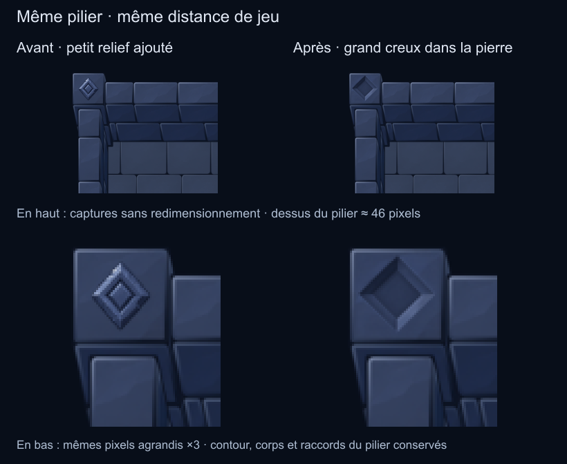

# Dessus de pilier sculpté — 24 octobre 2026

L'utilisateur trouvait les premiers décors trop détaillés à petite taille et
visuellement collés. Il a accepté de préparer un dessus interchangeable avec
sa pierre et un grand losange creusé. L'apparence de cette proposition attend
encore sa validation.

La première rangée contient des extraits Godot sans redimensionnement. Le dessus
du pilier mesure environ 46×46 pixels au cadrage de référence (192 px/case).
La seconde rangée agrandit ces mêmes pixels ×3, sans introduire de détails de la
source haute résolution. Le navigateur peut réduire toute la planche à l'affichage.

## Dessin et raccord

Un seul creux, quatre grandes faces ombrées et un fond calme. Les petits éclats,
anneaux et traits fins des anciennes propositions ont été abandonnés. La pierre
autour du motif fait partie du sprite supérieur pour créer une surface continue.

Le petit patch `pillar-top-carved` remplace visuellement la face supérieure du
pilier nu commun. Il contient la pierre et le creux ; le pilier nu reste dessous
pour conserver son contour exact et ses côtés. Aucune découpe ni peinture en jeu.

- La source générée remplit le même plan supérieur, de coordonnées
  (-46,7712 ; -110,976) à (14,6688 ; -49,536), en pixels de référence.
- Le compositeur hors ligne conserve 3 pixels de bordure d'origine, puis rejoint
  le matériau généré sur 3 pixels de pierre calme. Ce masque appartient au
  workflow de matériaux déjà autorisé, pas à une extraction de fond de médaillon.
- Le patch final partage l'ancre au sol du pilier : (-50 ; -114), cadre 68×68
  à la densité 256, puis 34×34 à 128. Aucun décalage supplémentaire de hauteur.
- Les pixels du patch sont limités à l'intérieur opaque du dessus aux deux
  densités. Les côtés et la silhouette du pilier proviennent toujours de la base.
- Le détail est dessiné juste après son support ; les murs situés devant peuvent
  le masquer. Le tri de profondeur de la scène reste celui de la correction précédente.

## Fichiers et reproduction

- `source/carved-top.png` : original ImageGen inchangé, généré avec l'outil intégré.
- `generation.json` : prompt exact, images de référence et chemin d'origine.
- `source/bare-top-reference.png` : cadrage de la face nue utilisé comme référence.
- `source/recipe-before.json`, `scene-before.png`, `bare-pillar.png` et
  `mobile_reference-before.gd.txt` : état avant cette proposition.
- `tools/mobile_pillar_cap.cjs` : export reproductible du dessus avec raccord.
- `preparation.json` : hashes, cadre, bordure et audits du compositeur.
- `prepared/top-carved-256.png`, `top-carved-128.png` : patches seuls.
- `prepared/pillar-carved-256.png`, `pillar-carved-128.png` : assemblages isolés.

1. `node tools/prepare_mobile_reference.cjs`.
2. Import Godot : `--headless --editor --import`.
3. Capture avec rendu réel : `--script res://tools/capture_mobile_reference.gd`.
4. `node tools/prepare_mobile_reference_review.cjs`.
5. `node tools/prepare_pillar_cap_review.cjs`.

F6 sur `scenes/MobileReference.tscn` montre le nouveau dessus par défaut. Le bouton
**Décors piliers** revient à la base nue ; le sélecteur conserve les anciens
médaillons sous les libellés **Ancien A/B/C** pour comparaison. Les anciens petits
décors muraux sont désactivés par défaut et identifiés comme anciens dans l'interface.

Le prototype contient 14 images, dont trois détails historiques. Le placement
des rectangles dans les atlas a été amélioré pour conserver les mêmes dimensions :
512×256 à 128 px/case et 1024×512 à 256 px/case. PNG respectifs : 83275 et 253634
octets ; RGBA brut inchangé à 0,5 et 2 Mio. Ces mesures concernent cette petite scène.

## Contrôles effectués

Les audits d'export aux deux densités donnent zéro différence d'alpha composée
et zéro pixel modifié hors de l'intérieur du dessus. La comparaison RGB utilise
le même passage du compositeur avec un patch transparent comme référence pour
neutraliser ses arrondis de couleur sur les pixels semi-transparents.

Import et neuf captures Godot : sortie 0 et stderr vide. Rendu 256 examiné à la
taille de jeu et comparatif avant/après inspecté. Aucun test automatisé, profilage
mobile ou migration du catalogue de production. Cette revue ne valide pas encore
d'autres motifs, de futures façades décorées ou toutes les configurations de murs.
